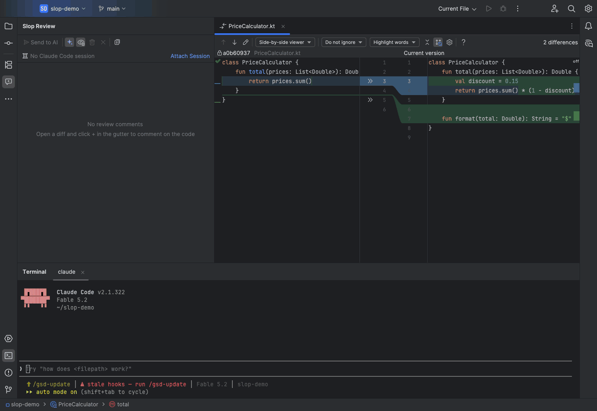
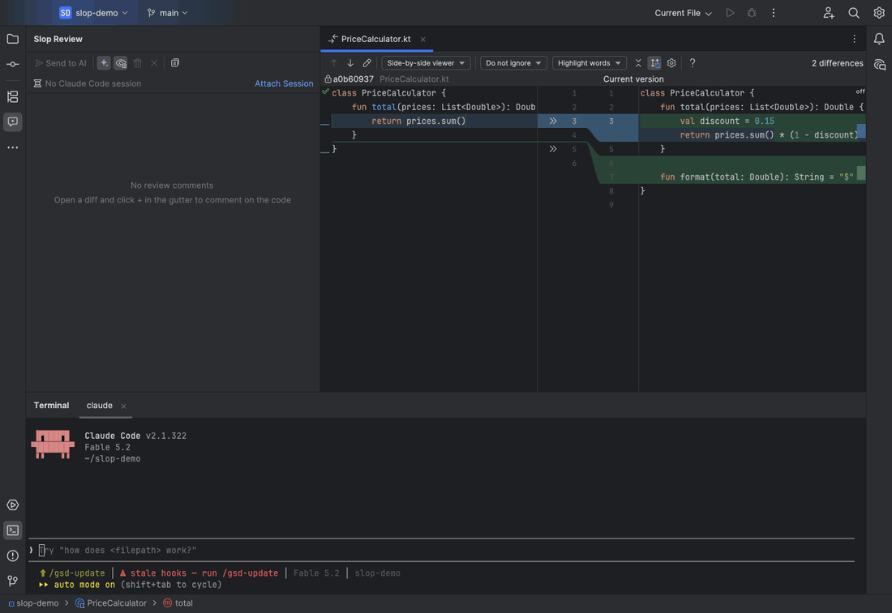
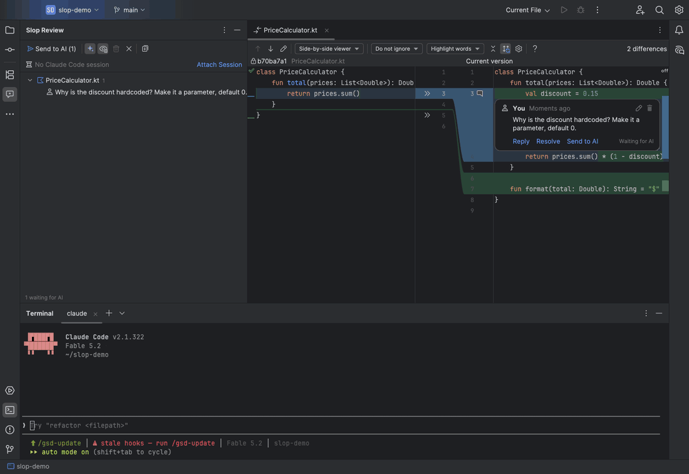
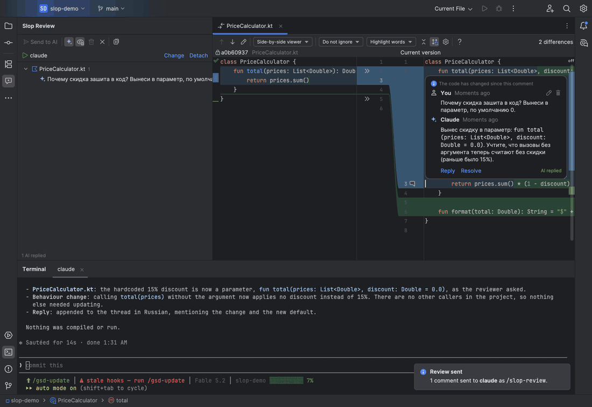
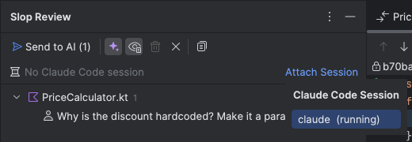
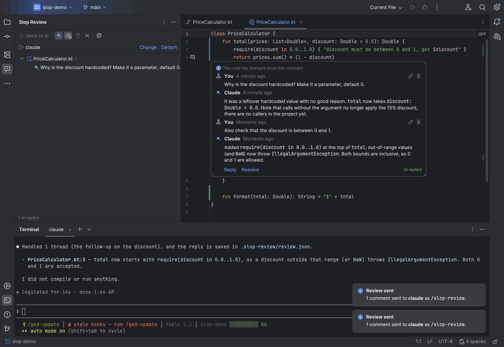
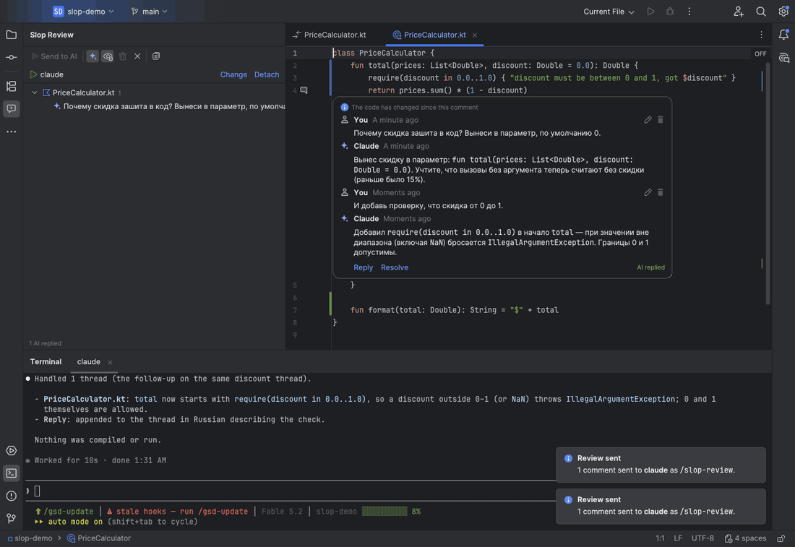
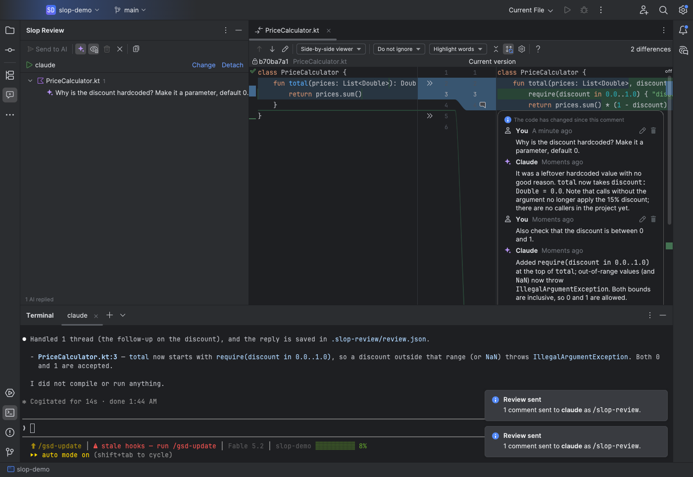

<div align="center">

# slop-review

**Code review for AI-written code, inside IntelliJ IDEA.**

Comment on a diff like you would in a pull request, send the review to the agent in your terminal,
and read its reply in the same thread.




</div>

## Why I got tired of reviewing

The agent writes code faster than I can read it. I still have to read it.

My review loop used to go like this. Open the diff and find something odd. Switch to the terminal
and type "in that file, around line forty, the discount thing, why is 0.15 hardcoded". Wait for the fix.
Go back to the diff, find the next odd thing, switch to the terminal again. By the fifth remark I had
forgotten the first one, and the agent had "improved" two things I never asked about.

For human teammates this was solved years ago: a pull request, a comment under the line, a thread.
For the agent sitting in the next terminal tab I had nothing like it. So I built slop-review. It is
a pull request that stays on my machine, with no push and no waiting, and the agent on the other end.

## Contents

- [Features](#features)
  - [Comments in the diff](#comments-in-the-diff)
  - [Send to Claude Code in one click](#send-to-claude-code-in-one-click)
  - [A discussion that keeps its context](#a-discussion-that-keeps-its-context)
  - [Attach a terminal session](#attach-a-terminal-session)
  - [Hide threads like Git Blame](#hide-threads-like-git-blame)
  - [Resolve and the thread list](#resolve-and-the-thread-list)
  - [Threads follow the code](#threads-follow-the-code)
  - [Other agents](#other-agents)
- [Install](#install)
- [Quick start](#quick-start)
- [How it works](#how-it-works)
- [Development](#development)
- [Limitations](#limitations)
- [FAQ](#faq)
- [License](#license)

## Features

### Comments in the diff

Open a regular IDEA diff: uncommitted changes from the Commit window, or any commit from Git Log.
Hover over the gutter, click **+**, and write a comment. It stays under the line, as in a pull request.



- **+** shows up on any line, including removed lines on the left side ("why did you delete this?").
- To comment on several lines, select them and run **Add Slop Review Comment** from the context menu,
  or press `⌃⇧K` on macOS and `Alt+Shift+K` on Windows and Linux.
- `⌘↵` / `Ctrl+Enter` submits, `Esc` cancels.
- You can edit and delete your own comments.

### Send to Claude Code in one click

**Send to AI** lives in two places: in the thread, next to Reply and Resolve, and in the panel toolbar.
The plugin types `/slop-review` into the attached terminal tab. The agent reads every comment that is
waiting for an answer, changes the code, and replies in the threads. The reply appears under the code
without a refresh.



- Every thread waiting for an answer is sent, including ones other than the thread you clicked in.
- Open files are saved first, so the agent sees what you see.
- When the agent replies, the IDE reloads files from disk and the diff under the thread shows the new code.
- Each thread shows its state: **Waiting for AI**, then **AI replied**.

### A discussion that keeps its context

If you disagree with the reply or want more, click **Reply** and send again. The next round goes to
the same session, so the agent remembers what you were talking about.



The agent can only reply. It may not close threads or edit your comments, so you decide when
a question is settled.

### Attach a terminal session

The **Slop Review** panel has a session row at the top. **Attach Session** lists the tabs of the
built-in terminal; pick the one running Claude Code. You do this once.



- While a session is attached, reviews go only there, even if another terminal tab is selected.
- **Change** picks another tab. **Detach** removes the link.
- If nothing is running in the attached tab, the plugin warns you and types nothing into the shell.
- With no session attached, the command is copied to the clipboard for you to paste.

### Hide threads like Git Blame

Threads also show in the regular editor. When they get in the way of reading code, one switch hides
them: right-click the gutter and choose **Show Slop Review Comments** (it sits next to Annotate with
Git Blame), or use the same button in the panel toolbar.



- A hidden thread leaves an icon in the gutter. Click it to open or close the thread on that line.
- The setting is saved per project and does not affect diffs.
- A comment you have just written stays open.

### Resolve and the thread list

**Resolve** collapses a thread to one line. The **Slop Review** panel lists all threads by file with
their state. Double-click a thread to open the file at that line.



| Panel button | What it does |
| --- | --- |
| **Send to AI (N)** | Sends the N comments waiting for an answer |
| **Show Slop Review Comments** | Shows threads under the code in the regular editor |
| **Show Resolved** | Shows resolved threads in the list |
| **Delete Resolved** / **Delete All** | Removes resolved threads / starts a new review |
| **Copy Review Prompt** | Copies a self-contained prompt for any agent |

### Threads follow the code

When the agent rewrites a file and lines move, the thread stays where it belongs. The plugin stores
the code fragment you commented on and finds it again. If the fragment itself changed, the thread
is marked "The code has changed since this comment" and stays in place.

### Other agents

The slash command targets Claude Code. For any other agent, **Copy Review Prompt** puts
a self-contained prompt with the file format on the clipboard.

## Install

You need IntelliJ IDEA 2025.2 or newer, and JDK 21 to build.

```bash
git clone git@github.com:Ersultanbek/slop-review.git
cd slop-review
JAVA_HOME=$(/usr/libexec/java_home -v 21) ./gradlew buildPlugin
```

Then open **Settings → Plugins → ⚙ → Install Plugin from Disk**, choose
`build/distributions/slop-review-0.1.0.zip`, and restart the IDE. The **Slop Review** panel appears
at the bottom left.

> The build uses the local IDEA at `/Applications/IntelliJ IDEA.app`.
> If yours is installed elsewhere, change the path in `build.gradle.kts`.

## Quick start

1. Start Claude Code in the built-in IDEA terminal and ask it to write something.
2. Open the diff: double-click a file in the Commit window.
3. Hover over the gutter, click **+**, write a comment.
4. In the **Slop Review** panel click **Attach Session** and pick the tab with Claude Code.
5. Click **Send to AI**.
6. Read the reply in the thread. **Reply** if you disagree, **Resolve** when you are done.



## How it works

**Storage.** A review is one file, `.slop-review/review.json`, in the project root. The folder is added
to `.git/info/exclude`, so it never ends up in a commit. Both sides read and write the file. The plugin
watches it and shows agent replies as they land.

```json
{
  "version": 1,
  "threads": [
    {
      "id": "tjbkssy",
      "status": "open",
      "file": "PriceCalculator.kt",
      "side": "new",
      "startLine": 3,
      "endLine": 3,
      "revision": null,
      "snippet": "        val discount = 0.15",
      "comments": [
        { "id": "c1bar68", "author": "user", "createdAt": "2026-11-11T20:30:55Z",
          "text": "Why is the discount hardcoded? Make it a parameter, default 0." },
        { "id": "c9ai4k2", "author": "ai", "name": "Claude", "createdAt": "2026-11-11T20:31:08Z",
          "text": "`total` now takes `discount: Double = 0.0`." }
      ]
    }
  ]
}
```

**The channel to the agent.** When a project opens, the plugin installs a slash command at
`~/.claude/commands/slop-review.md`. It tells the agent to read `review.json`, handle the threads where
the reviewer spoke last, change the code, and append a reply. The prompt is in
[`src/main/resources/prompts/slop-review.md`](src/main/resources/prompts/slop-review.md).
Sending a review means typing `/slop-review` and Enter into the attached terminal tab.

**UI.** Threads in the diff are built from the platform components that IDEA uses for GitHub and GitLab
reviews (`intellij.platform.collaborationTools`), so they look and behave the way you expect.

```
src/main/kotlin/dev/slopreview/
├── model/       ReviewThread, ReviewComment, JSON
├── store/       ReviewStore: reads and writes review.json
├── anchor/      finds the code fragment and tracks lines
├── editor/      diff and editor integration, gutter, inlays
├── ui/          thread and input components
├── toolwindow/  the Slop Review panel
├── send/        terminal sessions and sending to the agent
├── actions/     Send to AI, Attach Session, Add Comment, show/hide threads
└── selfcheck/   live self-check and demo recording
```

## Development

```bash
export JAVA_HOME=$(/usr/libexec/java_home -v 21)
./gradlew test          # unit and UI tests; UI snapshots go to build/ui-snapshots/
./gradlew buildPlugin   # build/distributions/*.zip
./gradlew runIde        # sandbox IDE with the plugin
```

**Live self-check.** It starts IntelliJ Community, runs the whole flow against a real diff and
terminal, and writes `result.txt` and screenshots to the folder you pass:

```bash
./gradlew runIde -PliveCheck=/path/to/out                     # cat stands in for the agent
./gradlew runIde -PliveCheck=/path/to/out -PliveAgent=claude  # real Claude Code
```

**The GIFs in this README** are recorded by the plugin in a live IDE with real Claude Code,
then assembled by a script:

```bash
./gradlew runIde -PliveDemo=/path/to/frames -PliveProject=/path/to/demo-project
python3 scripts/make-gifs.py /path/to/frames docs/images
```

The demo project must be a git repository with an uncommitted change in `PriceCalculator.kt`.

## Limitations

- Sending works only with the built-in IDEA terminal. External terminals are not visible to the
  plugin; for those the command is copied to the clipboard.
- The attached session is forgotten when the IDE restarts. Click Attach Session again.
- Double-clicking a thread in the panel opens the file but does not expand a hidden thread.
- The plugin uses experimental platform APIs, so a new IDEA version may require a rebuild.

## FAQ

**The agent answered `Unknown command: /slop-review`.**
That Claude Code session started before the command was installed and has not picked it up yet.
Send the review again or restart Claude Code in that tab.

**The agent's reply did not appear in the thread.**
Check that the agent appended its reply to `.slop-review/review.json` and that the file is still valid
JSON. If the agent broke the file, the plugin keeps the last good state and saves the broken version
next to it as `review.json.broken`.

**Can I review an old commit?**
Yes. A comment on a commit from Git Log stores the revision, and the agent receives it with the fragment.

**Does the review end up in git?**
No. `.slop-review/` is added to `.git/info/exclude`, a local ignore list that is never committed.

**Why "slop"?**
Because that is what you ship when nobody reviews it.

## License

No license has been chosen yet.
