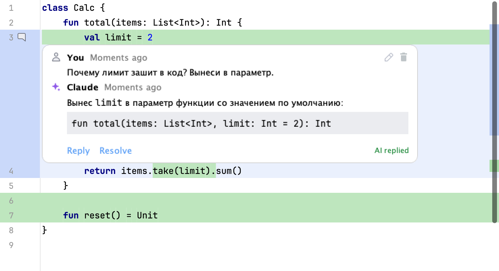
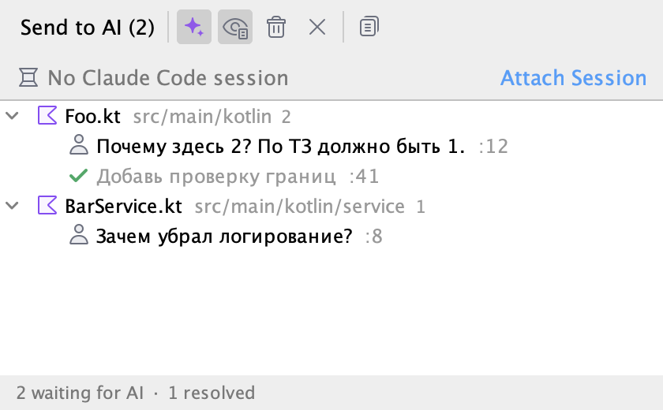

# AI Review

Плагин IntelliJ IDEA для локального ревью кода, который написал ИИ-агент.
Комментируешь diff прямо в IDE, как в pull request, отправляешь ревью агенту в терминал —
он правит код и отвечает в тех же тредах под кодом.



## Возможности

- **Комментарии в родном diff IDEA** — незакоммиченные изменения (окно Commit) и коммиты (Git Log).
  «+» на гаттере или выделение нескольких строк, тред раскрывается под кодом.
- **Дискуссия в треде** — Reply, Resolve, правка и удаление своих комментариев, markdown в ответах агента.
- **Привязка к сессии Claude Code** — выбираешь вкладку встроенного терминала один раз, и все раунды
  ревью уходят в неё: агент ведёт дискуссию в одном контексте.
- **Отправка в один клик** — `Send to AI` в панели или прямо в треде.
- **Скрытие тредов в редакторе** — как Git Blame: один переключатель прячет все треды в обычном
  редакторе, на строках остаются значки в гаттере.
- **Панель AI Review** — все треды по файлам, статусы «Waiting for AI» / «AI replied» / «Resolved».
- **Тред не теряет код** — привязка к фрагменту, а не только к номеру строки; если код изменился,
  тред помечается как устаревший.

## Установка

Нужны IntelliJ IDEA 2025.2+ и JDK 21 для сборки.

```bash
JAVA_HOME=$(/usr/libexec/java_home -v 21) ./gradlew buildPlugin
```

Затем **Settings → Plugins → ⚙ → Install Plugin from Disk** → `build/distributions/ai-review-plugin-0.1.0.zip`
и перезапуск IDE. Слева внизу появится панель **AI Review**.

## Как пользоваться

1. **Открой diff.** Двойной клик по файлу в окне Commit или по файлу коммита в Git Log.
2. **Оставь комментарий.** Наведи на гаттер и нажми «+» рядом со строкой. Чтобы прокомментировать
   несколько строк — выдели их и вызови **Add AI Review Comment** (контекстное меню,
   `⌃⇧K` на macOS, `Alt+Shift+K` на Windows/Linux). Отправка комментария — `⌘↵` / `Ctrl+Enter`.
3. **Привяжи сессию.** Вверху панели **AI Review** есть строка сессии. Нажми в ней **Attach Session**
   и выбери вкладку встроенного терминала, где запущен Claude Code. Это делается один раз: пока сессия
   привязана, ревью уходит только в неё, даже если активна другая вкладка. Там же — **Change**
   (выбрать другую вкладку) и **Detach** (отвязать).
4. **Отправь ревью.** Нажми **Send to AI** — в тулбаре панели или в самом треде, рядом с Reply и Resolve.
   Уходят все комментарии, ждущие ответа, а не только текущий тред.
5. **Читай ответы.** Агент правит код и отвечает в тредах — они обновляются сами, статус меняется
   на «AI replied». Дальше — **Reply** (и снова Send to AI) или **Resolve**.


Ссылка **Send to AI** видна в треде, пока он ждёт ответа агента.

### Треды в обычном редакторе

Треды видны не только в diff, но и в обычном редакторе файла. Чтобы они не мешали читать код,
их можно скрыть: правый клик по гаттеру → **Show AI Review Comments** (там же, где Annotate with Git Blame),
либо та же кнопка в тулбаре панели AI Review. Настройка запоминается для проекта и на diff не влияет.

Когда треды скрыты, на строке с комментарием остаётся значок в гаттере: клик по нему открывает
и закрывает тред этой строки. Только что написанный комментарий остаётся раскрытым.

### Панель AI Review



| Действие | Что делает |
| --- | --- |
| Строка сессии: **Attach Session** / **Change** / **Detach** | Привязать, сменить или отвязать вкладку терминала с Claude Code |
| **Send to AI (N)** | Отправить N комментариев, ждущих ответа |
| **Show AI Review Comments** | Показывать треды под кодом в обычном редакторе |
| **Show Resolved** | Показывать закрытые треды в списке |
| **Delete Resolved** / **Delete All** | Убрать закрытые треды / начать ревью заново |
| **Copy Review Prompt** | Скопировать самодостаточный промпт для любого другого агента |

Двойной клик по треду открывает файл на нужной строке.

### Что происходит при отправке

| Ситуация | Результат |
| --- | --- |
| Сессия привязана, в ней работает Claude Code | В неё отправляется `/ai-review` |
| Сессия не привязана, но вкладки терминала есть | Плагин сначала спросит, в какую отправить |
| Вкладок нет или сессия недоступна | `/ai-review` остаётся в буфере обмена — вставь в Claude Code сам |
| В привязанной вкладке ничего не запущено | Предупреждение; команда в shell не отправляется |
| Claude Code не установлен (`~/.claude` нет) | В буфер копируется полный промпт для любого агента |

## Как устроено

- **Хранилище.** Ревью лежит в `.ai-review/review.json` в корне проекта; папка сама добавляется
  в `.git/info/exclude`. Файл читают и пишут и плагин, и агент: плагин следит за изменениями
  и сразу показывает ответы.
- **Канал к агенту.** При первой отправке плагин ставит slash-команду в `~/.claude/commands/ai-review.md`.
  Команда велит агенту прочитать `review.json`, обработать треды, где последнее слово за ревьюером,
  поправить код и дописать ответ. Текст промпта и формат файла — в
  [`src/main/resources/prompts/ai-review.md`](src/main/resources/prompts/ai-review.md).
- **Привязка к коду.** Тред хранит фрагмент кода и находит его заново после правок; в открытых файлах
  позицию ведут `RangeMarker`-ы. Комментарий к удалённому коду (левая сторона diff) помечается `side: "old"`.
- **Интерфейс.** Треды в diff построены на тех же платформенных компонентах, что и ревью GitHub/GitLab
  в IDEA (`intellij.platform.collaborationTools`).

```
src/main/kotlin/dev/aireview/
├── model/       ReviewThread, ReviewComment, JSON
├── store/       ReviewStore — чтение/запись review.json
├── anchor/      поиск фрагмента и отслеживание строк
├── editor/      интеграция с diff и редактором, гаттер, инлеи
├── ui/          компоненты треда и поля ввода
├── toolwindow/  панель AI Review
├── send/        сессии терминала и отправка агенту
└── actions/     Attach Session, Send to AI, Add Comment
```

## Разработка

```bash
export JAVA_HOME=$(/usr/libexec/java_home -v 21)
./gradlew test          # юнит- и UI-тесты; снимки интерфейса — в build/ui-snapshots/
./gradlew buildPlugin   # build/distributions/*.zip
./gradlew runIde        # IDE-песочница с плагином
```

Плагин собирается против локальной IDEA (`/Applications/IntelliJ IDEA.app`, см. `build.gradle.kts`).

Живая самопроверка поднимает IntelliJ Community, проходит весь сценарий (diff → комментарий → отправка
в терминал → ответ) и сохраняет скриншоты и `result.txt` в указанную папку:

```bash
./gradlew runIde -PliveCheck=/path/to/empty/dir                    # вместо агента — cat
./gradlew runIde -PliveCheck=/path/to/empty/dir -PliveAgent=claude # настоящий Claude Code
```

## Ограничения

- Отправка работает только во встроенный терминал IDEA; для внешних терминалов команда копируется в буфер.
- Привязка сессии не переживает перезапуск IDE — после него нужно снова нажать Attach Session.
- Slash-команда рассчитана на Claude Code; для других агентов есть **Copy Review Prompt**.
- Используются экспериментальные API платформы, поэтому под новую версию IDEA плагин может
  потребовать пересборки.
